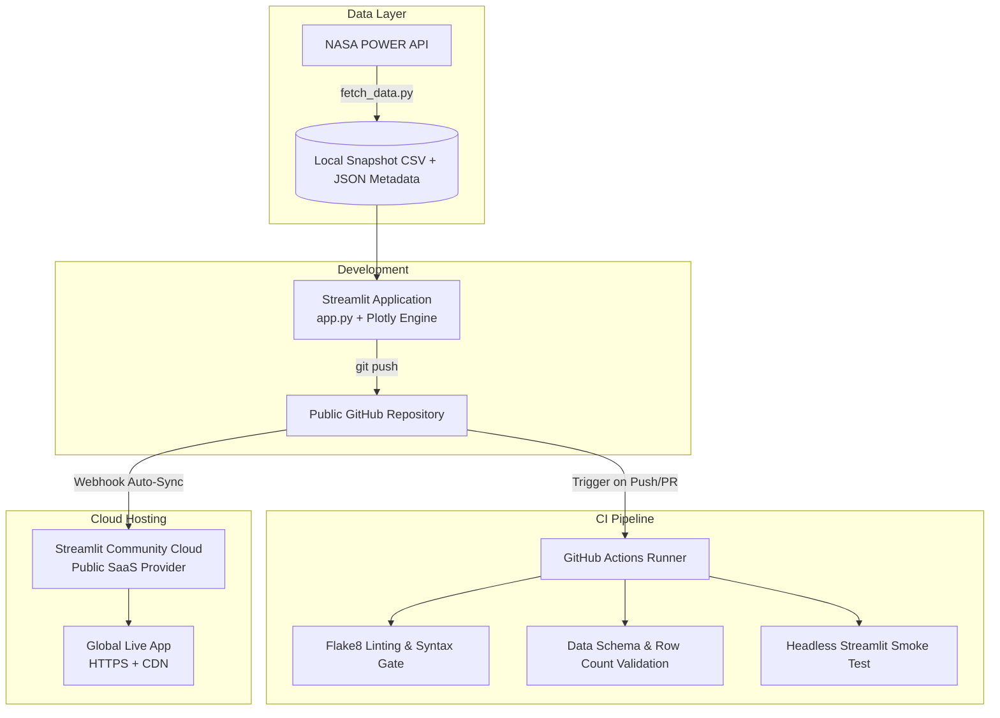

> 💡 **Executive Summary:** Variable renewable energy assets face a fundamental challenge: weather-driven intermittency. In Peru's coastal desert, however, the intense thermal trade winds known as the *Vientos Paracas* surge during the very winter months when coastal fog attenuates solar irradiance. To investigate this natural synergy, we built an interactive analytics dashboard in pure Python using **Streamlit** and **Plotly**, backed by 5 years of daily satellite and reanalysis observations from **NASA POWER** (1,827 days), with automated CI/CD testing via **GitHub Actions** and continuous cloud deployment.

**Project Links:**  
[🚀 Live Cloud Dashboard](https://paracas-renewable-energy-explorer.streamlit.app) · [📦 GitHub Repository](https://github.com/GianfrancoArocutipa/paracas-renewable-energy-explorer) · [🧪 Automated CI Pipeline](https://github.com/GianfrancoArocutipa/paracas-renewable-energy-explorer/actions) · [🛰️ NASA POWER API](https://power.larc.nasa.gov/)

---

## ⚡ The Clean Energy Challenge in Coastal Peru

The transition toward a decarbonized electrical grid depends heavily on understanding meteorological dynamics. Traditional questions posed by energy engineers and grid planners are inherently multi-variable:
- *At what hub heights do coastal trade winds reach commercially viable velocities ($> 6.0\ m/s$)?*
- *How severely does winter cloud cover degrade photovoltaic generation?*
- *Can co-locating wind turbines and solar panels balance out generation profiles to deliver stable, base-load clean electricity?*

In Peru, the coastal province of **Paracas and Pisco (13.83°S, 76.25°W)** is an exceptional natural laboratory. Situated along the Pacific Humboldt Current, the cold upwelling waters collide with the sun-scorched Atacama-Sechura coastal desert. This thermal gradient triggers the renowned *Vientos Paracas*—powerful southern trade winds that make this corridor home to Peru's flagship wind farms, including the **Wayra Wind Project (132 MW)**.

Static PDF reports and spreadsheet exports cannot answer dynamic what-if engineering scenarios: *What happens to capacity factor if cut-in speed is raised to 3.5 m/s? How many tons of $CO_2$ are displaced annually if we size a hybrid plant at 50 MW wind and 30 MW solar?*

To answer these questions, we designed an interactive web dashboard that brings raw scientific data into an accessible, real-time exploratory interface.

---

## 🛠️ Selecting the Toolchain: The Case for Streamlit + Plotly

When developing data applications, visualization frameworks present distinct architectural tradeoffs:

| Visualization Framework | Primary Strength | Architectural Consideration | Fit for this Project |
| :--- | :--- | :--- | :--- |
| **Seaborn / Matplotlib** | In-depth statistical plotting in Jupyter notebooks | Static bitmaps, lacks interactive UI controls | Ideal for initial EDA, not for production web dashboards |
| **Bokeh** | Standalone HTML serialization with client-side JavaScript callbacks | Extremely fast for simple 1-2 widget views; requires a dedicated Bokeh Server for complex reactive state | Excellent for serverless single-page widgets; heavier to maintain for multi-tab apps |
| **Dash (Plotly)** | Enterprise full-stack reactive applications | Demands explicit Flask boilerplate, CSS layouts, and callback decorators | Powerful, but slower iteration velocity for rapid prototyping |
| **Streamlit** | Converts Python scripts into reactive web applications with zero HTML/JS | Executes top-to-bottom; relies on `@st.cache_data` for high performance | **Chosen tool:** Fast declarative UI, seamless Plotly integration, pure Python ecosystem |

Combining **Streamlit** for application layout and **Plotly** for hardware-accelerated interactive visualizations allowed us to build an executive-grade analytics platform with sub-second filter response times.

---

## 🛰️ The Scientific Data Layer: NASA POWER (2020–2024)

Rather than simulating synthetic dummy variables, the dashboard is anchored by **5 complete years of real observations (1,827 daily records)** retrieved from the **NASA Prediction Of Worldwide Energy Resources (POWER)** project.

### Target Node Specifications:
- **Location:** Paracas / Pisco Clean Energy Corridor, Ica, Peru
- **Coordinates:** Latitude `-13.83° S`, Longitude `-76.25° W`
- **Temporal Window:** January 1, 2020 to December 31, 2024 (1,827 daily records)
- **Key Parameters:**
  - `T2M`: Temperature at 2 meters (°C)
  - `ALLSKY_SFC_SW_DWN`: Daily solar irradiance ($kWh/m^2/day$)
  - `WS50M`: Wind speed at commercial hub height (50 meters, $m/s$)
  - `WS10M`: Wind speed at standard surface anemometer height (10 meters, $m/s$)
  - `WD50M`: Wind direction at 50 meters (degrees azimuth)
  - `RH2M`: Relative humidity (%)

### Architectural Decision: Deterministic Data Snapshot
Instead of making synchronous HTTP requests to NASA's API on every user visit (which would risk rate limits, slow initial page loads, and third-party downtime), we wrote `fetch_data.py` to curate and bundle a validated data snapshot in `data/paracas_renewable_daily.csv` accompanied by `data/metadata.json`.

This guarantees **deterministic, instant loading** across local environments and cloud servers.

---

## 📊 Inside the Analytical Engine: 5 Core Modules

The dashboard is structured around five focused analytical perspectives:

### 1. Dual-Axis Temporal Cycles & Rolling Trends
Daily weather data exhibits high day-to-day variance. To highlight underlying climatological patterns, the application computes **14-day rolling averages** for both wind velocity and solar irradiance. An interactive dual-axis Plotly line chart lets users track how seasonal fronts shift over the 5-year observation period.

### 2. 16-Sector Polar Wind Rose & Weibull Distribution
To evaluate wind turbine orientation (azimuth), we bin all 1,827 daily directional records into a 16-compass-point polar bar chart, categorized into four velocity classes:

```python
# Binning directions into 16 compass sectors (22.5° each)
bins = np.arange(0, 360 + 22.5, 22.5)
labels = ["N", "NNE", "NE", "ENE", "E", "ESE", "SE", "SSE", "S", "SSW", "SW", "WSW", "W", "WNW", "NW", "NNW"]

df_rose["speed_class"] = pd.cut(
    df_rose["wind_speed_50m_ms"],
    bins=[0, 4, 7, 10, 25],
    labels=["< 4 m/s (Low)", "4 - 7 m/s (Moderate)", "7 - 10 m/s (High)", "> 10 m/s (Gale)"]
)
df_rose["dir_sector"] = pd.cut(df_rose["wind_direction_50m_deg"] % 360, bins=bins, labels=labels, include_lowest=True)
```

The data reveals a striking geographic signature: **over 70% of wind energy in Paracas originates from the South to South-Southwest (180°–210°)**, providing a clear design orientation for wind farm developers.

Additionally, the dashboard fits an empirical **Weibull probability density curve** ($k \approx 2.2$, $c \approx 8.1\ m/s$), standard in wind resource assessment.

### 3. The Wind-Solar Complementarity Matrix
The central scientific takeaway is captured in the complementarity tab:
- **Summer (Dec–Mar):** Solar irradiance reaches its zenith ($> 7.2\ kWh/m^2/day$), offsetting lighter morning wind periods.
- **Winter & Spring (Jun–Nov):** Dense coastal thermal gradients generate sustained afternoon and evening trade winds ($> 7.8\ m/s$), compensating for the seasonal dip in solar yields.

### 4. Interactive Hybrid Plant Yield Simulator
Users can configure custom asset capacities:
- **Wind Farm Capacity (MW):** Uses a piecewise power curve model (cut-in $3.0\ m/s$, rated $12.0\ m/s$, cut-out $25.0\ m/s$).
- **Solar PV Capacity (MWp):** Applies a system performance ratio ($PR = 0.78$) against incident daily irradiance.

The simulator outputs annual clean energy generation (MWh), equivalent Peruvian households electrified, and avoided metric tons of $CO_2$ relative to the Peruvian national grid (SEIN) thermal emission factor ($\approx 0.42\ tCO_2/MWh$).

### 5. Geospatial Context & Data Export
An embedded map displays the study coordinates alongside operating renewable facilities in the region (such as the Wayra Wind Farm in Marcona). A complete filtered CSV can be downloaded in memory with one click.

---

## 🏗️ GitOps Architecture: From Code to Global Deployment

The system follows modern continuous integration and delivery practices:



---

## 🧪 Automated Testing with GitHub Actions

To guarantee that code changes do not break production, we established an automated CI workflow in `.github/workflows/ci.yml`.

Every commit and pull request must clear three distinct quality gates:

1. **Static Analysis (Flake8):** Checks for syntax errors, undefined names, and structural code violations:
   ```bash
   flake8 . --count --select=E9,F63,F7,F82 --show-source --statistics
   ```
2. **Dataset Integrity Verification:** Asserts that the pinned CSV snapshot contains at least 1,800 records and verifies that all expected meteorological columns exist.
3. **Headless Startup Smoke Test:** Boots Streamlit in headless mode for 12 seconds to ensure all UI widgets compile without throwing unhandled exceptions:
   ```bash
   timeout 12s streamlit run app.py --server.headless=true --server.port=8501 || [ $? -eq 124 ]
   ```

With this automated test suite, regressions are caught before they ever reach end users.

---

## ☁️ Zero-Downtime Deployment to Streamlit Community Cloud

The public application is hosted on **Streamlit Community Cloud**, connected directly to our GitHub repository:

1. The repository is configured as public: `GianfrancoArocutipa/paracas-renewable-energy-explorer`.
2. Within the Streamlit Cloud console, we link the repository, set the branch to `main`, and designate `app.py` as the entrypoint.
3. Every subsequent `git push` to `main` triggers a zero-downtime rolling reload in the cloud container.

---

## 📋 Project Deliverables Summary

| Resource | Link |
| :--- | :--- |
| 📦 **Source Code Repository** | [github.com/GianfrancoArocutipa/paracas-renewable-energy-explorer](https://github.com/GianfrancoArocutipa/paracas-renewable-energy-explorer) |
| 🚀 **Live Production Dashboard** | [paracas-renewable-energy-explorer.streamlit.app](https://paracas-renewable-energy-explorer.streamlit.app) |
| 🧪 **Continuous Integration Workflow** | [.github/workflows/ci.yml](https://github.com/GianfrancoArocutipa/paracas-renewable-energy-explorer/actions) |
| 🛰️ **Meteorological Data Provider** | [NASA Langley Research Center POWER Project](https://power.larc.nasa.gov/) |

---

## 💡 Practical Engineering Takeaways

1. **Memoization is Essential:** Uncached functions in Streamlit run top-to-bottom on every slider click. By wrapping dataset loading and simulation logic with `@st.cache_data`, interactions remain instantaneous.
2. **Bundle Verified Snapshots for Production:** Do not rely on third-party live APIs during production startup. Committing a vetted snapshot (`data/paracas_renewable_daily.csv`) ensures 100% build reliability.
3. **Automate the Headless Test:** Running `timeout 12s streamlit run` in CI catches subtle runtime incompatibilities before pushing to production.
4. **Visual Design Hierarchy:** Injecting a concise CSS snippet for custom metric cards and setting consistent tokens in `.streamlit/config.toml` elevates an open-source prototype into a professional-grade tool.

---

## 🎯 Conclusion & Future Extensions

By bridging **Streamlit**, **Plotly**, **NASA POWER data**, and **GitHub Actions**, we built an intuitive clean energy analytics application that proves the seasonal harmony of wind and solar resources in southern coastal Peru.

Future iterations could expand this architecture by incorporating battery energy storage system (BESS) dispatch models and connecting directly to Peru's COES grid frequency feeds.

*Have thoughts on renewable energy modeling or automated GitOps pipelines? Drop a comment below or star the [GitHub Repository](https://github.com/GianfrancoArocutipa/paracas-renewable-energy-explorer)!*
