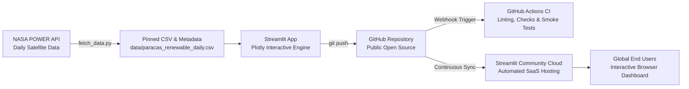

# ⚡ Paracas Renewable Wind & Solar Energy Explorer

[](https://streamlit.io/)
[](https://www.python.org/)
[](https://github.com/placeholder-user/paracas-renewable-energy-explorer/actions)
[](https://power.larc.nasa.gov/)
[](https://opensource.org/licenses/MIT)

> **An interactive clean energy analytics dashboard built with Python, Streamlit, and Plotly. Powered by 5 years of daily satellite and atmospheric reanalysis data from NASA POWER (2020–2024) to evaluate wind-solar complementarity and hybrid plant dispatch in Peru's premier coastal corridor (Paracas / Pisco, Ica).**

---

## 🌟 Live Demo & Public Deployment

- 🚀 **Live Cloud Dashboard:** [https://paracas-renewable-energy-explorer.streamlit.app](https://paracas-renewable-energy-explorer.streamlit.app) *(Deploy via Streamlit Community Cloud)*
- 📦 **Public GitHub Repository:** [https://github.com/placeholder-user/paracas-renewable-energy-explorer](https://github.com/placeholder-user/paracas-renewable-energy-explorer)
- 📝 **Technical Article (Dev.to / Medium):** See [ARTICLE_DEV_TO.md](ARTICLE_DEV_TO.md)

---

## 🧭 Why Paracas, Peru?

The coastal region of **Paracas and Pisco (13.83°S, 76.25°W)** is famous for its fierce thermal winds (*Vientos Paracas*), driven by the Pacific Humboldt Current and the coastal desert terrain. It is the heart of Peru's commercial wind energy infrastructure (e.g., Wayra Wind Farm and Tres Hermanas).

This application explores a fundamental clean energy engineering question:  
**How do coastal trade winds and intense solar irradiance complement each other throughout the year, and how can a hybrid wind-solar installation ensure stable base-load clean electricity?**

---

## 📐 System Architecture & GitOps Flow



### Key Workflow Highlights:
1. **Deterministic Data Snapshot:** 1,827 daily observations from 2020 to 2024 are bundled in `data/`, guaranteeing reproducible builds without network timeouts.
2. **Sub-second Reactivity:** Uses `@st.cache_data` for in-memory memoization.
3. **Automated CI/CD:** GitHub Actions executes static linting (Flake8), data schema validation, and headless server testing on every commit.
4. **Zero-Configuration SaaS Deployment:** Automatic updates deployed to Streamlit Community Cloud upon pushing to `main`.

---

## 📊 Core Features

- **Executive KPI Metric Scorecards:** Real-time metrics for mean wind speed (at 50m hub height and 10m anemometer), solar irradiance, wind power density (W/m²), and estimated hybrid capacity factors.
- **Dual-Axis Temporal Trends:** Daily time series with 14-day rolling averages showing wind velocity surges against seasonal solar curves.
- **Wind Rose & Directional Analysis:** Polar bar chart classifying wind direction by speed categories, highlighting the prevailing South-Southwest (180°–210°) trade wind corridor.
- **Weibull Wind Distribution Fit:** Empirical probability density histogram fitted with Weibull scale ($c$) and shape ($k$) parameters.
- **Wind-Solar Complementarity Matrix:** Monthly aggregated dual-axis chart demonstrating how winter wind surges compensate for reduced winter solar radiation.
- **Interactive Hybrid Plant Yield Simulator:** User-configurable Wind Farm (MW) and Solar PV (MWp) capacity inputs with daily generation curves (MWh), annual yields, and avoided metric tons of $CO_2$.
- **Geospatial Context & Data Exporter:** Interactive map of Peru's coastal energy nodes, complete tabular inspection, and instant CSV export.

---

## 📁 Repository Structure

```text
paracas-renewable-energy-explorer/
├── .github/
│   └── workflows/
│       └── ci.yml               # Automated CI pipeline (linting, schema validation & smoke tests)
├── .streamlit/
│   └── config.toml              # Modern dark theme & production server flags
├── data/
│   ├── paracas_renewable_daily.csv   # 1,827 daily records from NASA POWER (2020-2024)
│   └── metadata.json                 # Dataset coordinates, parameters, units & license
├── app.py                       # Main interactive Streamlit application
├── fetch_data.py                # NASA POWER API ingestion & snapshot script
├── requirements.txt             # Pinned Python package dependencies
├── .gitignore                   # Ignore cache, venv, and OS metadata
├── README.md                    # Comprehensive repository documentation
└── ARTICLE_DEV_TO.md            # Ready-to-publish Dev.to / Medium article
```

---

## 🚀 Local Installation & Execution

### Prerequisites
- Python 3.9, 3.10, or 3.11
- Git

### 1. Clone the Repository
```bash
git clone https://github.com/placeholder-user/paracas-renewable-energy-explorer.git
cd paracas-renewable-energy-explorer
```

### 2. Create and Activate a Virtual Environment
```bash
# On Linux / macOS:
python3 -m venv .venv
source .venv/bin/activate

# On Windows (PowerShell):
python -m venv .venv
.venv\Scripts\Activate.ps1
```

### 3. Install Dependencies
```bash
pip install --upgrade pip
pip install -r requirements.txt
```

### 4. Run the Streamlit Dashboard
```bash
streamlit run app.py
```
Open your browser at `http://localhost:8501`.

---

## 🧪 Automated Testing & CI/CD Pipeline

The project includes an automated GitHub Actions workflow (`.github/workflows/ci.yml`) that validates:
1. **Code Quality:** Static analysis and syntax check using `flake8`.
2. **Data Integrity:** Validates that `data/paracas_renewable_daily.csv` has 1,800+ rows and all required columns.
3. **Headless Compilation:** Runs `streamlit run app.py --server.headless=true` to guarantee zero startup exceptions.

To run these checks locally:
```bash
# Lint check
flake8 . --count --select=E9,F63,F7,F82 --show-source --statistics

# Smoke test
python -c "import app; print('App syntax verified!')"
```

---

## ☁️ Deployment to Public SaaS (Streamlit Community Cloud)

1. Push this repository to your public GitHub account.
2. Go to [share.streamlit.io](https://share.streamlit.io/) and log in with GitHub.
3. Click **"New app"**.
4. Select your repository, set branch to `main`, and main file path to `app.py`.
5. Click **"Deploy!"** — your app will be live with free global SSL hosting in ~2 minutes.

---

## 📜 Data Citation & License

- **Data Source:** NASA Langley Research Center (LaRC) POWER Project, funded through the NASA Earth Science/Applied Science Program.
- **Coordinates:** -13.83° S, -76.25° W (Paracas, Ica, Peru).
- **License:** This project is open-source under the [MIT License](LICENSE).
